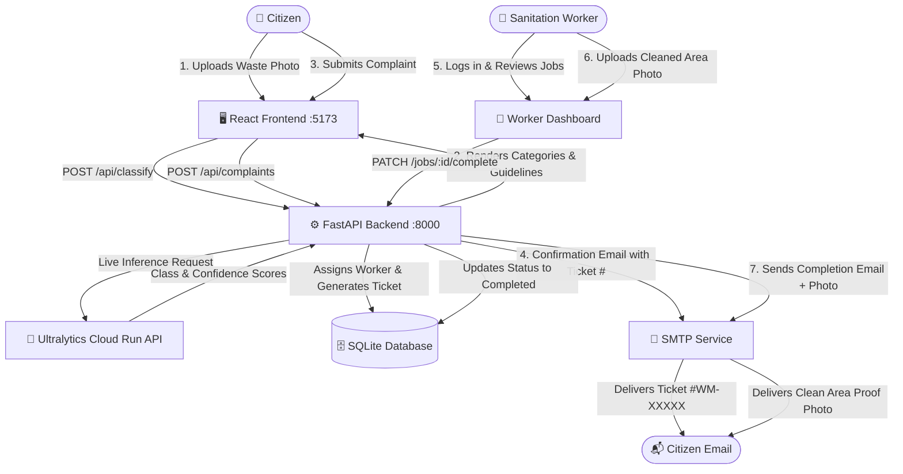

# ♻️ Smart Waste Management with AI Waste Classification

A modern, responsive full-stack municipal waste management and illegal dumping tracking platform. The system combines an AI inference pipeline powered by a deployed **Ultralytics YOLO** model, automatic or manual worker dispatch, real-time 3-step citizen complaint tracking, and email notifications with **attached clean-area photo verification**.

---

## 📋 Table of Contents
- [System Architecture](#-system-architecture)
- [Key Features](#-key-features)
- [AI Waste Classification Model](#-ai-waste-classification-model)
- [Email Notification System](#-email-notification-system)
- [Technology Stack](#-technology-stack)
- [Project Directory Structure](#-project-directory-structure)
- [Quick Start Guide](#-quick-start-guide)
- [REST API Reference](#-rest-api-reference)
- [Worker Management](#-worker-management)
- [Testing & Quality Assurance](#-testing--quality-assurance)

---

## 🏛 System Architecture



---

## 🌟 Key Features

### 1. Citizen Waste Reporting (`/` or `/report`)
- **Photo Upload**: Drag-and-drop or select photos (JPG, JPEG, PNG, WEBP up to 15MB).
- **Instant AI Detection**: Calls your live Ultralytics model, displaying classified categories, count badges, and confidence meters (`Math.round(confidence * 100)%`).
- **Category-Specific Safety Advice**: Displays practical cleanup protocols (segregation, puncture-proof glass handling, biomedical disposal, e-waste guidelines).
- **Worker Assignment**:
  - **Auto-Assign (Default)**: Automatically picks the least-busy active worker in the database.
  - **Direct Selection**: Allows selecting any specific registered worker from the database via a dropdown.
- **GPS Location Detection**: One-click browser geolocation (`📍 Detect current location`).
- **Ticket Generation**: Generates unique complaint ticket IDs in `WM-XXXXX` format (e.g. `WM-84476`).
- **Email Confirmation**: Automatically sends the ticket number, report details, and tracking link to the citizen's email.

### 2. Live Citizen Tracking (`/track`)
- **Ticket Search**: Real-time lookup by ticket number (e.g. `WM-84476`).
- **3-Step Status Timeline**:
  - `Pending`: Complaint received and queued.
  - `Assigned`: Worker reviewing cleanup and safety protocols.
  - `Completed`: Cleaned, verified, and closed.
- **Before & After Photos**: Shows original reported waste image side-by-side with the worker's cleaned area proof photo.
- **Assigned Worker Details**: Displays the name and contact information of the assigned sanitation worker.
- **Interactive Map Link**: "Open in Maps ↗" navigation to the exact coordinates or street address.

### 3. Sanitation Worker Portal (`/worker`)
- **Real Worker Authentication**: Clean sign-in form without hardcoded demo credentials.
- **Self-Registration**: New sanitation workers can register their own accounts (`Full Name`, `Username`, `Phone`, `Password`) and immediately log in.
- **Active Job Dashboard**: Real-time list of all complaints assigned to the worker from the database.
- **Suggested Cleanup Method**: Category-specific safety reminders tailored to the detected waste types.
- **Proof of Cleanup Verification**: File selector for uploading proof photo of the cleared area.
- **One-Click Completion**: Transitions the complaint status to `Completed` and triggers the citizen email with the attached proof photo.

---

## 🤖 AI Waste Classification Model

The project is connected to an Ultralytics deployed model running on Google Cloud Run:

- **Endpoint**: `https://predict-6addb30660ff18ac6953805d-dproatj77a-el.a.run.app/predict`
- **Task**: `classify` (Image Classification)

### Supported Classes (18 Categories)

| Model Raw Class | Formatted Display Name | Waste Stream / Safety Protocol |
| :--- | :--- | :--- |
| `batteries` | **Batteries** | Hazardous / Insulated protective gloves, depot disposal |
| `cans_all_type` | **Metal Cans** | Recyclable Scrap Metal / Puncture-resistant gloves |
| `ceramic_product` | **Ceramic Waste** | Puncture-proof bins / Inert disposal |
| `coffee_tea_bags` | **Coffee & Tea Bags** | Organic Wet-Waste / Composting |
| `diapers` | **Sanitary Diapers** | High-Heat Incineration / Separate sanitary bags |
| `e-waste` | **Electronic Waste** | Certified E-Waste Depot / Prevent moisture exposure |
| `egg_shells` | **Egg Shells** | Organic Composting / Soil enrichment |
| `food_scraps` | **Food Scraps** | Aerobic Composting / Disinfect area |
| `glass_containers` | **Glass Containers** | Heavy-duty Puncture Proof / Recyclable Glass |
| `kitchen_waste` | **Kitchen Waste** | Wet-Waste Biogas / Composting |
| `paints` | **Paints & Chemicals** | Hazardous Chemical PPE / Sealed chemical drums |
| `paper_products` | **Paper & Cardboard** | Dry-Waste Recycling / Keep dry and bundled |
| `pesticides` | **Pesticides & Toxic** | Toxic Hazmat Protocol / N95 respirator mask |
| `plastic_bottles` | **Plastic Bottles** | PET/HDPE Recyclable / Rinse and crush |
| `platics_bags_wrappers` | **Plastic Bags & Wrappers** | Soft-Plastic Stream / Clean film recycling |
| `sanitary_napkin` | **Sanitary Napkins** | Biomedical Packaging / Incineration |
| `stroform_product` | **Styrofoam Products** | EPS Densification / Prevent drain fragmentation |
| `yard_trimmings` | **Yard & Garden Trimmings** | Green-Waste Mulch / Organic processing |

*(Local offline `.pt` weights via Ultralytics PyTorch are also supported if placed in `model/best.pt`).*

---

## 📧 Email Notification System

The application dispatches two automated emails to citizens:

1. **Ticket Confirmation Email**: Dispatched immediately upon filing a report. Contains the prominent ticket badge (e.g. `WM-84476`), location, assigned worker, and a link to live tracking.
2. **Cleanup Completion Email**: Dispatched when the worker clicks "Mark as completed". Contains verification details, an embedded HTML card, and the **clean area photo attached directly as an image file**.

### SMTP Configuration (Gmail Setup)

To deliver real emails to inboxes:

1. Enable **2-Step Verification** on your Google Account.
2. Go to [https://myaccount.google.com/apppasswords](https://myaccount.google.com/apppasswords).
3. Create an app password named `SmartWaste` and copy the 16-letter code.
4. Update lines 31–36 in `backend/.env`:
   ```env
   SMTP_SERVER=smtp.gmail.com
   SMTP_PORT=587
   SMTP_USERNAME=your_email@gmail.com
   SMTP_PASSWORD=your_16_letter_app_password
   SMTP_FROM=your_email@gmail.com
   SMTP_USE_TLS=True
   ```
5. *(Optional)* If `SMTP_SERVER` is left blank, the system operates in **Simulation Mode**, logging the email and attachment details in the database without failing.

---

## 🛠 Technology Stack

- **Frontend**:
  - React 18 (SPA)
  - Vite 8
  - Lucide React (Icons)
  - Custom Design System (Vanilla CSS with tailored HSL tokens)
- **Backend**:
  - Python 3.10+ / FastAPI 0.115+
  - SQLAlchemy 2.0 (ORM)
  - Pydantic v2 & Pydantic-Settings
  - HTTPX (Asynchronous HTTP client)
  - Python-Multipart, Pillow, Passlib (Bcrypt)
  - Pytest (Automated testing)
- **Database**:
  - SQLite (`backend/waste_management.db`)
- **AI Engine**:
  - Ultralytics YOLO26 / PyTorch

---

## 📂 Project Directory Structure

```
WasteAnti/
├── README.md                      # Project documentation
├── .gitignore
├── backend/
│   ├── .env                       # Environment configuration (API keys, SMTP)
│   ├── .env.example               # Template environment configuration
│   ├── requirements.txt           # Python dependencies
│   ├── scratch_test_yolo.py       # Standalone verification script for YOLO API
│   ├── waste_management.db       # SQLite local database
│   ├── uploads/                   # Uploaded waste & cleanup proof photos
│   ├── tests/
│   │   └── test_api.py            # Automated test suite
│   └── app/
│       ├── main.py                # FastAPI entry point & lifespan seed
│       ├── config.py              # Pydantic environment settings
│       ├── database.py            # SQLAlchemy database engine & sessions
│       ├── models.py              # DB Models: Worker, Complaint, Detection, Notification
│       ├── schemas.py             # Pydantic request/response schemas
│       ├── routes/
│       │   ├── auth.py            # Worker login & registration
│       │   ├── classify.py        # Image classification route
│       │   ├── complaints.py      # Complaint filing, tracking, assignment
│       │   └── workers.py         # Worker jobs list & cleanup completion
│       └── services/
│           ├── auth.py            # Password hashing & JWT token verification
│           ├── classifier.py      # YOLO API client, parsing, & local weights runner
│           ├── notifications.py   # MIME Multipart email dispatch with attachments
│           └── worker_assignment.py # Least-busy worker assignment engine
├── frontend/
│   ├── package.json
│   ├── vite.config.js             # Vite config with backend API proxy
│   ├── index.html
│   └── src/
│       ├── App.jsx                # Page routing & global toast notifications
│       ├── index.css              # Design tokens & responsive styles
│       ├── components/
│       │   ├── Header.jsx         # Navigation bar
│       │   ├── StatusTracker.jsx  # 3-step timeline progression
│       │   └── WasteDetectionCard.jsx # Waste item meters
│       ├── pages/
│       │   ├── ReportPage.jsx     # Citizen waste reporting form
│       │   ├── SuccessPage.jsx    # Complaint ticket confirmation
│       │   ├── TrackPage.jsx      # Citizen tracking portal
│       │   └── WorkerDashboard.jsx # Worker jobs & completion portal
│       └── services/
│           └── api.js             # API client functions
└── model/
    ├── README.md                  # YOLO integration guide
    └── best.pt                    # Optional offline weights file
```

---

## 🚀 Quick Start Guide

### Prerequisites
- Python 3.10 or higher
- Node.js (v18+) and npm

---

### Step 1: Start the Backend (Terminal 1)

```powershell
cd d:\WasteAnti\backend
python -m pip install -r requirements.txt
python -m uvicorn app.main:app --reload --port 8000
```

- **Backend API**: [http://localhost:8000](http://localhost:8000)
- **Interactive Swagger Docs**: [http://localhost:8000/docs](http://localhost:8000/docs)
- **Health Check**: [http://localhost:8000/api/health](http://localhost:8000/api/health)

---

### Step 2: Start the Frontend (Terminal 2)

```powershell
cd d:\WasteAnti\frontend
npm install
npm run dev
```

- **Frontend Application**: [http://localhost:5173](http://localhost:5173)

---

## 🌐 REST API Reference

| Method | Endpoint | Description |
| :--- | :--- | :--- |
| `GET` | `/api/health` | Health status and AI model configuration mode (`api` / `local` / `demo`) |
| `POST` | `/api/classify` | Upload photo & run YOLO classification inference |
| `GET` | `/api/workers` | Retrieve all registered workers from database with active job counts |
| `POST` | `/api/auth/register` | Register a new sanitation worker account |
| `POST` | `/api/auth/login` | Authenticate worker & return JWT bearer token |
| `GET` | `/api/auth/me` | Get currently authenticated worker profile |
| `POST` | `/api/complaints` | Submit waste report, assign worker, & send confirmation email |
| `GET` | `/api/complaints/{public_id}` | Retrieve public complaint details, detections, & timeline |
| `PATCH` | `/api/complaints/{public_id}/assign` | Reassign complaint to another worker in the database |
| `GET` | `/api/workers/jobs` | Retrieve authenticated worker's open assigned jobs |
| `PATCH` | `/api/workers/jobs/{public_id}/complete` | Mark job completed, upload proof photo, & send email to citizen |

---

## 👷 Worker Management

### Real Worker Accounts
Workers can register directly at **[http://localhost:5173/worker](http://localhost:5173/worker)** using the **Register New Worker** tab.
- Passwords are encrypted with `bcrypt`.
- Newly registered workers immediately appear in the worker assignment pool and on the citizen report form.

### Pre-Seeded Default Workers
If the database is clean, the system automatically initializes default workers:
- `ravi` / `password123`
- `priya` / `password123`
- `amit` / `password123`

---

## 🧪 Testing & Quality Assurance

### Run Backend Unit & Integration Tests
```powershell
cd d:\WasteAnti\backend
python -m pytest
```

### Test YOLO Model Endpoint Standalone
```powershell
cd d:\WasteAnti\backend
python scratch_test_yolo.py
```

### Validate Production Frontend Build
```powershell
cd d:\WasteAnti\frontend
npm run build
```

---

## 📄 License
This project is open-source and intended for municipal and environmental waste management initiatives.
