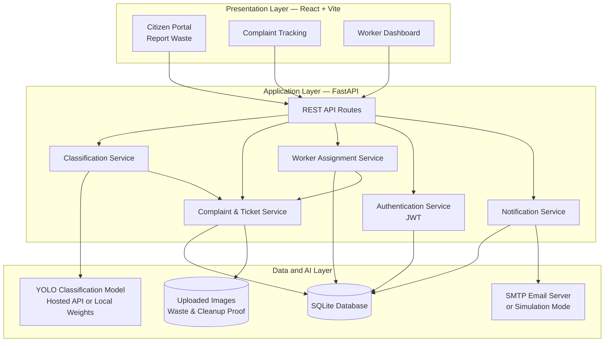
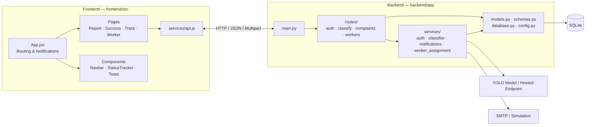
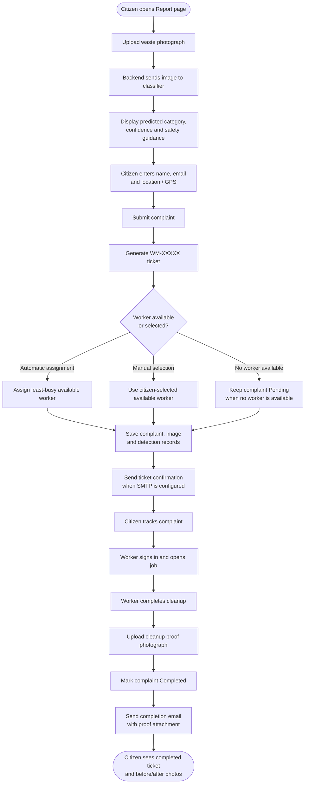
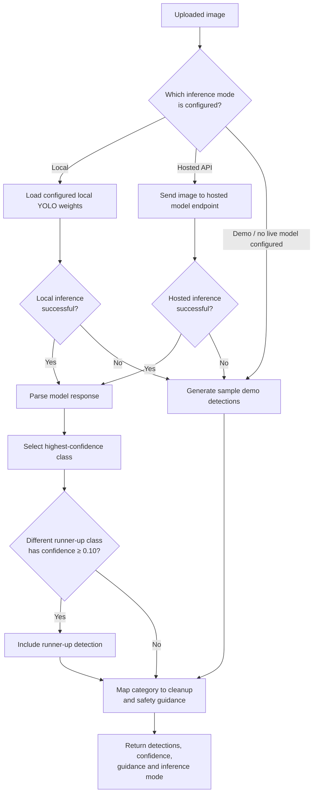
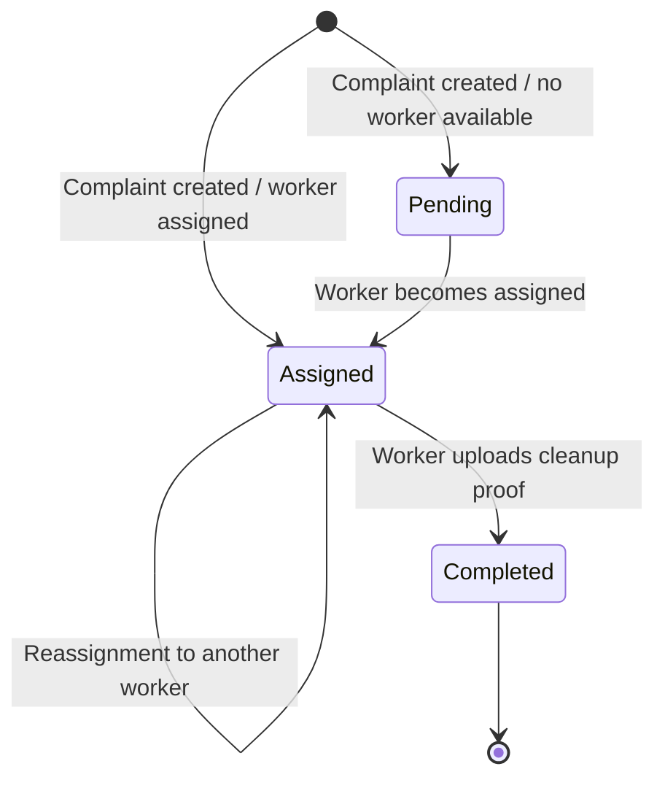
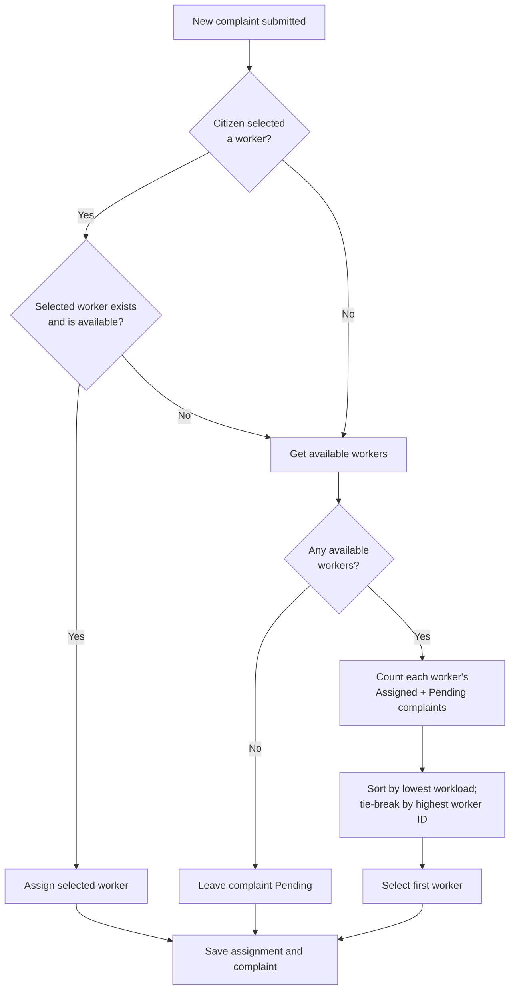
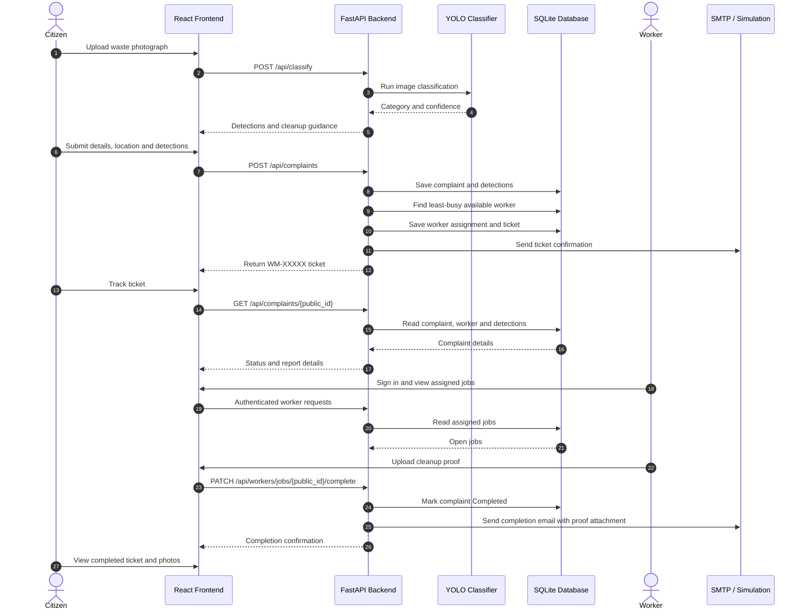
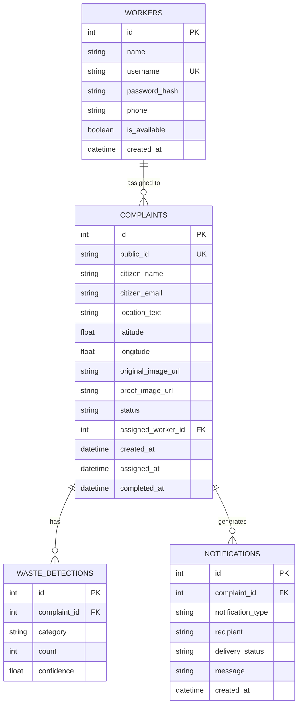
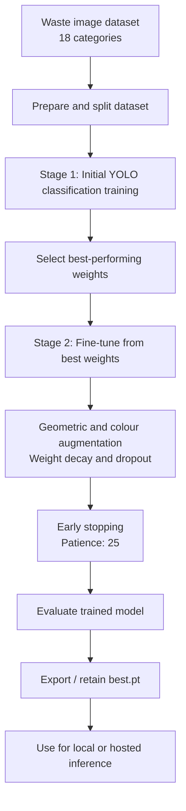

# ♻️ AI-Based Smart Waste Management and Monitoring System

An AI-powered, full-stack web platform for reporting, classifying, assigning, and tracking municipal waste-cleanup complaints. Citizens can upload a waste photograph, review AI-generated classification and safety guidance, submit a location-based complaint, and track its progress. Sanitation workers can manage assigned jobs and upload photographic proof when cleanup is complete.

**Repository:** https://github.com/Groot-077/waste-management

---

## Table of Contents

- [Overview](#overview)
- [Key Features](#key-features)
- [System Workflow](#system-workflow)
- [AI Waste Classification](#ai-waste-classification)
- [Technology Stack](#technology-stack)
- [Architecture](#architecture)
- [Project Structure](#project-structure)
- [Prerequisites](#prerequisites)
- [Installation and Setup](#installation-and-setup)
- [Environment Configuration](#environment-configuration)
- [Application URLs](#application-urls)
- [REST API](#rest-api)
- [Testing](#testing)
- [Known Limitations](#known-limitations)
- [Future Enhancements](#future-enhancements)
- [Security Notes](#security-notes)
- [Contributors](#contributors)
- [Acknowledgement](#acknowledgement)

---

## Overview

Traditional waste-reporting processes can make it difficult for citizens to identify waste types, know who is responsible for cleanup, and confirm that a reported location has been cleaned. This project connects citizens and sanitation workers through an AI-assisted complaint-management workflow.

The application uses an Ultralytics YOLO image-classification model trained for 18 waste categories. After a citizen uploads a photograph, the system returns predicted waste categories, confidence information, and category-specific handling guidance. The citizen can then submit a complaint with a manually entered location or browser-detected GPS coordinates.

Each complaint receives a unique ticket in the `WM-XXXXX` format. The system assigns the complaint to the least-busy available worker by default, while also supporting worker selection. Citizens can follow a three-stage status timeline and view the original report photograph alongside the cleanup proof photograph.

## Key Features

### Citizen reporting

- Upload JPG, JPEG, PNG, or WEBP photographs (up to 15 MB).
- Receive AI waste-classification results and confidence information.
- View safety and cleanup guidance for detected waste categories.
- Enter a location or use browser geolocation.
- Automatically assign the complaint to the least-busy available worker or select a worker.
- Receive a unique complaint ticket and an email confirmation when SMTP is configured.

### Complaint tracking

- Search for a complaint using its `WM-XXXXX` ticket number.
- Follow the **Pending → Assigned → Completed** status timeline.
- View assigned worker details.
- View the original waste photograph and cleanup proof photograph.
- Open the reported location in a map application.

### Sanitation worker portal

- Register and sign in to a worker account.
- Authenticate worker API requests using JWT bearer tokens.
- View assigned open jobs.
- Review waste-specific cleanup and safety guidance.
- Upload a photograph showing the cleaned area.
- Complete a job and trigger a citizen notification with the proof photograph attached when email is configured.

### Resilient inference and notifications

- Supports hosted-model, local-model, and demo inference modes.
- Supports email delivery through SMTP and a simulation mode when SMTP is not configured.
- Keeps core application modules separate so inference and notification services can be configured independently.

## System Workflow

1. A citizen opens the reporting page and uploads a photograph of dumped waste.
2. The backend sends the image to the configured classification service.
3. The application displays the predicted waste category, confidence, and relevant handling guidance.
4. The citizen enters contact details and a location, then submits the complaint.
5. The backend generates a ticket and assigns a worker.
6. The citizen receives a confirmation email when SMTP is configured and can track the ticket.
7. The worker signs in, reviews the assigned job, cleans the location, and uploads proof.
8. The complaint is marked **Completed** and a completion email with the proof photograph is sent when SMTP is configured.

## AI Waste Classification

The project uses an Ultralytics YOLO image-classification model trained for 18 waste categories.

| Model class | Display category |
|---|---|
| `batteries` | Batteries |
| `cans_all_type` | Metal Cans |
| `ceramic_product` | Ceramic Waste |
| `coffee_tea_bags` | Coffee & Tea Bags |
| `diapers` | Sanitary Diapers |
| `e-waste` | Electronic Waste |
| `egg_shells` | Egg Shells |
| `food_scraps` | Food Scraps |
| `glass_containers` | Glass Containers |
| `kitchen_waste` | Kitchen Waste |
| `paints` | Paints & Chemicals |
| `paper_products` | Paper & Cardboard |
| `pesticides` | Pesticides & Toxic Waste |
| `plastic_bottles` | Plastic Bottles |
| `platics_bags_wrappers` | Plastic Bags & Wrappers |
| `sanitary_napkin` | Sanitary Napkins |
| `stroform_product` | Styrofoam Products |
| `yard_trimmings` | Yard & Garden Trimmings |

The classifier produces a single primary class for an image. The application may also show a runner-up class when its confidence meets the configured threshold. It does not currently draw bounding boxes or count every individual object in a mixed-waste photograph.

### Inference options

- **Hosted inference:** Uses the configured deployed model endpoint.
- **Local inference:** Uses local Ultralytics weights when `model/best.pt` is available and configured.
- **Demo mode:** Returns clearly identified sample detections when live inference is unavailable or not configured.

For local inference, place the model weights at `model/best.pt` and configure the model path in `backend/.env`. Do not commit large model files unless you have intentionally chosen an appropriate Git LFS or model-storage strategy.

## Technology Stack

| Layer | Technologies |
|---|---|
| Frontend | React, Vite, JavaScript, CSS, Lucide React |
| Backend | Python, FastAPI, Uvicorn, Pydantic |
| ORM and data | SQLAlchemy, SQLite |
| AI / inference | Ultralytics YOLO, PyTorch, hosted inference API |
| Authentication | JWT bearer tokens |
| Image handling | Python-Multipart, Pillow |
| Notifications | SMTP, MIME email attachments |
| Testing | Pytest, FastAPI TestClient |

## Architecture

The platform follows a three-layer architecture. The React frontend communicates with the FastAPI backend through REST endpoints. The backend coordinates classification, complaint processing, worker assignment, authentication, database operations, and notifications.

### 1. High-Level System Architecture



### 2. Component Architecture



### 3. End-to-End Complaint Workflow

This diagram shows the main citizen-to-worker journey, from uploading a waste photograph to receiving cleanup confirmation.



### 4. AI Inference Decision Flow

The classifier supports local, hosted API, and demo inference. Demo results are flagged so they are distinguishable from live model predictions.



### 5. Complaint Status Lifecycle



A complaint begins as **Assigned** when a worker is assigned at submission time; otherwise it begins as **Pending**. Reassignment keeps it in the **Assigned** state. Completion requires a proof photograph. Completed complaints cannot be completed again.

### 6. Least-Busy Worker Assignment Flow

The assignment service considers workers whose `is_available` value is true. It counts each worker's complaints in `Assigned` or `Pending` status and selects the worker with the smallest active workload. When workloads are tied, the worker with the higher ID is selected. A valid, available worker explicitly selected by the citizen takes priority over automatic assignment.



The selection rule is:

\[
w^* = \arg\min_{w \in W} \left(L(w), -id(w)\right)
\]

where \(W\) is the set of available workers and \(L(w)\) is the number of complaints assigned to worker \(w\) whose status is `Assigned` or `Pending`.

### 7. Sequence Diagram — Report to Verified Cleanup



### 8. Database Entity-Relationship Diagram

The persistent data model contains four entities: `workers`, `complaints`, `waste_detections`, and `notifications`. One worker can be assigned multiple complaints. Each complaint can have multiple waste-detection records and notification records.



**Relationship summary**

| Relationship | Cardinality | Meaning |
|---|---|---|
| Worker → Complaint | One-to-many | A worker can handle multiple complaints |
| Complaint → Waste Detection | One-to-many | A complaint can store multiple detected categories |
| Complaint → Notification | One-to-many | A complaint can generate multiple email notification records |

Deleting a complaint cascades to its associated detection and notification records.

### 9. Model Training and Fine-Tuning Pipeline

The project report describes a two-stage training process: initial training followed by fine-tuning from the best weights of the first stage.



Reported fine-tuning settings include a maximum of 100 epochs, image size 320, batch size 16, initial learning rate 0.0003, and early-stopping patience of 25. Actual model evaluation metrics should be added from the training results rather than estimated.

## Project Structure

```text
WasteAnti/
├── README.md
├── .gitignore
├── backend/
│   ├── .env.example
│   ├── requirements.txt
│   ├── scratch_test_yolo.py
│   ├── tests/
│   │   └── test_api.py
│   └── app/
│       ├── __init__.py
│       ├── config.py
│       ├── database.py
│       ├── main.py
│       ├── models.py
│       ├── schemas.py
│       ├── routes/
│       │   ├── auth.py
│       │   ├── classify.py
│       │   ├── complaints.py
│       │   └── workers.py
│       └── services/
│           ├── auth.py
│           ├── classifier.py
│           ├── notifications.py
│           └── worker_assignment.py
├── frontend/
│   ├── package.json
│   ├── package-lock.json
│   ├── vite.config.js
│   ├── index.html
│   └── src/
│       ├── App.jsx
│       ├── App.css
│       ├── index.css
│       ├── main.jsx
│       ├── components/
│       │   ├── Navbar.jsx
│       │   ├── StatusTracker.jsx
│       │   └── Toast.jsx
│       ├── pages/
│       │   ├── ReportPage.jsx
│       │   ├── SuccessPage.jsx
│       │   ├── TrackPage.jsx
│       │   └── WorkerDashboard.jsx
│       └── services/
│           └── api.js
└── model/
    └── README.md
```

Runtime files such as `.env`, the SQLite database, uploaded photographs, and local model weights may be created separately and are not required to be committed to Git.

## Prerequisites

Install the following before running the application:

- Python 3.10 or later
- Node.js 18 or later
- npm
- Git

For live AI inference, configure either the hosted model endpoint or local model weights. For real email delivery, configure an SMTP account. Without SMTP configuration, the application can use its notification simulation mode.

## Installation and Setup

### 1. Clone the repository

```bash
git clone https://github.com/Groot-077/waste-management.git
cd waste-management
```

### 2. Configure the backend

Open a terminal in the project directory:

```bash
cd backend
python -m venv .venv
```

Activate the virtual environment.

**Windows PowerShell:**

```powershell
.venv\Scripts\Activate.ps1
```

**macOS / Linux:**

```bash
source .venv/bin/activate
```

Install dependencies:

```bash
python -m pip install -r requirements.txt
```

Create your local environment file by copying the example:

**Windows PowerShell:**

```powershell
Copy-Item .env.example .env
```

**macOS / Linux:**

```bash
cp .env.example .env
```

Edit `backend/.env` with your own configuration, then start the backend:

```bash
python -m uvicorn app.main:app --reload --port 8000
```

### 3. Configure the frontend

Open a second terminal from the project root:

```bash
cd frontend
npm install
npm run dev
```

Open the local frontend URL printed by Vite (normally `http://localhost:5173`).

### 4. Build the frontend

From the `frontend` directory:

```bash
npm run build
```

## Environment Configuration

Use `backend/.env.example` as the source of truth for the environment-variable names supported by the current backend. Typical settings include:

- Model inference mode, hosted endpoint, API key, and/or local model path.
- Database connection URL.
- JWT secret and token configuration.
- SMTP server, port, username, password, sender address, and TLS setting.
- Frontend/public application URL used when generating tracking links, if supported by the current configuration.

For Gmail SMTP, enable 2-Step Verification and create an App Password in your Google Account. Use that App Password as the SMTP password; do not use your normal Google account password.

**Never commit `backend/.env`, real API keys, SMTP credentials, JWT secrets, or other private configuration values.** Keep `.env.example` limited to placeholder values.

## Application URLs

When running locally with the commands above:

| Service | URL |
|---|---|
| Frontend | http://localhost:5173 |
| Backend | http://localhost:8000 |
| Interactive API documentation | http://localhost:8000/docs |
| API health check | http://localhost:8000/api/health |

## REST API

The backend exposes the following main endpoints:

| Method | Endpoint | Purpose |
|---|---|---|
| `GET` | `/api/health` | Check service health and inference mode |
| `POST` | `/api/classify` | Upload an image and run waste classification |
| `GET` | `/api/workers` | List registered workers and workload information |
| `POST` | `/api/auth/register` | Register a sanitation worker |
| `POST` | `/api/auth/login` | Authenticate a worker |
| `GET` | `/api/auth/me` | Get the authenticated worker profile |
| `POST` | `/api/complaints` | Submit a waste complaint |
| `GET` | `/api/complaints/{public_id}` | Retrieve public complaint and tracking details |
| `PATCH` | `/api/complaints/{public_id}/assign` | Reassign a complaint |
| `GET` | `/api/workers/jobs` | List the authenticated worker's open jobs |
| `PATCH` | `/api/workers/jobs/{public_id}/complete` | Upload cleanup proof and complete a job |

For request schemas and interactive testing, run the backend and open `http://localhost:8000/docs`.

## Testing

Run the backend test suite from the `backend` directory with the virtual environment activated:

```bash
python -m pytest
```

To test the hosted YOLO endpoint using the project's standalone test script:

```bash
python scratch_test_yolo.py
```

Build the frontend to check that it compiles:

```bash
cd ../frontend
npm run build
```

## Known Limitations

The project report identifies the following limitations in the current prototype:

- **Single-label classification:** A photograph receives one primary class; mixed waste is not individually detected with bounding boxes.
- **Dataset dependence:** Performance on real street photographs depends on how representative the training dataset is.
- **Security hardening:** The report identifies the current password-hashing approach and permissive CORS configuration as items that need improvement before production use.
- **Photo access:** Uploaded photographs are served without authenticated access in the current prototype.
- **Deployment scale:** SQLite and a single application process are suitable for a prototype, but larger deployments need more scalable infrastructure.
- **Email links:** The tracking URL must be configured appropriately for the deployed environment rather than left pointing to localhost.

This repository should be treated as a project prototype, not as a production-ready municipal service.

## Future Enhancements

Potential next steps identified in the project report include:

- Upgrade from image classification to object detection with bounding boxes and per-object counts.
- Collect and label more real-world field images and retrain the model.
- Strengthen authentication and security with bcrypt or Argon2, restricted CORS, strong environment-supplied JWT secrets, rate limiting, and protected photo access.
- Add an administrator dashboard with complaint heat maps, response-time statistics, and worker performance.
- Detect duplicate complaints using location and image similarity.
- Add SMS, push notifications, multilingual support, and a mobile application.
- Consider PostgreSQL, background task queues, external object storage, expanded test coverage, and continuous integration.
- Explore location-aware worker assignment.

## Security Notes

- Keep `.env` files and credentials out of version control.
- Use strong, unique secrets in deployed environments.
- Configure CORS to allow only trusted frontend origins.
- Use production-grade password hashing before deploying to real users.
- Restrict access to uploaded images and validate uploaded files.
- Do not use development or demo credentials in a public deployment.

## Contributors

This project was developed as part of **BCSE497J – Project-I**, Bachelor of Technology in Computer Science and Engineering, Vellore Institute of Technology (VIT), Vellore.

| Name | Register number |
|---|---|
| Jaipal Prakash | 23BCE0310 |
| Nikhil Kumar | 23BCE0404 |
| Satyam Raj | 23BCE0275 |

**Project Guide:** Dr. Karthika M S  
**Department:** School of Computer Science and Engineering (SCOPE), VIT Vellore

## Acknowledgement

We sincerely thank our project guide, Dr. Karthika M S, and the School of Computer Science and Engineering at VIT Vellore for their guidance and support throughout this project.

---

If you find this project useful, consider giving the repository a ⭐ on GitHub.
